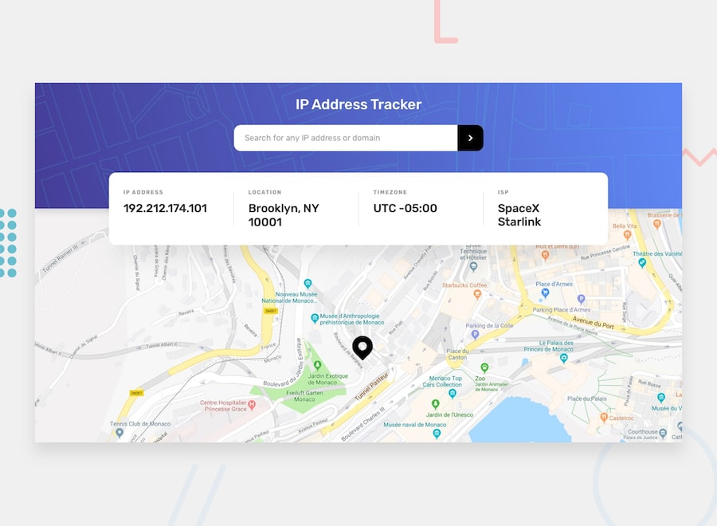

# IP Address Tracker



A web app that looks up an IPv4 address and shows where it is on a map. Type in an IP, hit the arrow, and the page shows the address, location, timezone, and internet provider, then moves the map pin to that spot.

https://kdotsin.github.io/ip-address-tracker/

## Features

- Search any IPv4 address and get its city, region, postal code, UTC offset, and ISP
- Interactive map that pans to the searched location and moves the marker
- Input validation: the app checks that the IP has four numbers between 0 and 255 before calling the API, and shows "Enter a valid IP" if it doesn't
- Responsive layout: the info cards stack on mobile and sit in a row with dividers on desktop
- The info panel overlaps the header and the map, so the search area and map read as one screen

## Built With

- **HTML** with semantic markup (`<header>`, `<main>`, and a `<dl>` for the info cards)
- **Tailwind CSS v4** (browser build), with custom component classes made with `@apply`
- **TypeScript** in strict mode, compiled to `dist/`
- **[Leaflet](https://leafletjs.com/)** for the map, with [OpenStreetMap](https://www.openstreetmap.org/) tiles
- **[IPify Geolocation API](https://geo.ipify.org/)** for the IP data

## Project Structure

```
ip-address-tracker/
├── index.html            # Page layout and Tailwind component styles
├── src/
│   ├── index.ts          # Form handling, validation, map setup, DOM updates
│   ├── api/
│   │   └── ipLookup.ts   # getIpInfo(): calls the IPify API and returns an IpInfo
│   ├── models/
│   │   └── ipInfo.ts     # LocationData / IpInfoData interfaces and IpInfo class
│   └── images/           # Background patterns, icons, favicon
├── dist/                 # Compiled JavaScript (what index.html loads)
├── tsconfig.json
└── package.json
```

### How it works

1. `index.ts` sets up the Leaflet map and a marker, then listens for the form's `submit` event.
2. When you search, `isValidIp()` checks the input. If it's invalid, the cards show an error and nothing is sent.
3. If it's valid, `getIpInfo()` in `api/ipLookup.ts` fetches the data from IPify and wraps it in an `IpInfo` object.
4. `index.ts` fills in the four cards and calls `map.setView()` and `pin.setLatLng()` to move to the new location.

## Getting Started

1. Clone the repo and install dependencies:
   ```bash
   npm install
   ```
2. Compile the TypeScript:
   ```bash
   npx tsc
   ```
3. Serve the folder with a local server (the compiled code uses ES modules, so opening the file directly won't work). For example, use the VS Code Live Server extension, or run:
   ```bash
   npx serve .
   ```
4. Open the page in your browser and search for an IP address.

## Known Limitations

- Only IPv4 addresses are supported. Domain names and IPv6 addresses don't pass validation.
- The map starts on a default location in New York instead of the visitor's own IP.
- The API key is in the client-side code, so anyone viewing the source can see it.

## Reflection

Building this tracker was my first time connecting TypeScript, an outside API, and a map library in one project. I started with the HTML and Tailwind layout, using a description list for the four info cards so each label stayed paired with its value. Then I moved on to the TypeScript and split it into three parts: an `api` folder for the fetch call, a `models` folder for the `IpInfo` interfaces and class, and `index.ts` to handle the form and update the page. Keeping them separate made it much easier to figure out where a bug was coming from.

The biggest challenge was getting Leaflet to work with TypeScript. Leaflet loads from a CDN script tag, so TypeScript didn't know `L` existed. I fixed this by installing `@types/leaflet` and adding a `declare const L` line, which gave me type checking without bundling the library. Another challenge was getting the info panel to overlap the header and the map like the design. I positioned it absolutely, pushed it down with `translate-y-1/2`, and gave the map a lower z-index so the panel stayed on top.

I also noticed that bad input was being sent straight to the API, so I wrote an `isValidIp` function that checks for four numbers between 0 and 255 before making any request.

If I keep working on this, the first thing I would do is move the API key out of the frontend and behind a small server, since right now anyone can see it. I would also load the visitor's own IP when the page opens, add domain and IPv6 search, show a friendly message when a lookup fails instead of throwing an error, and write tests for the validation function.
